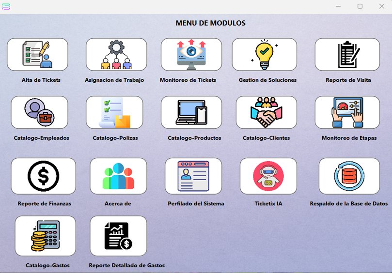
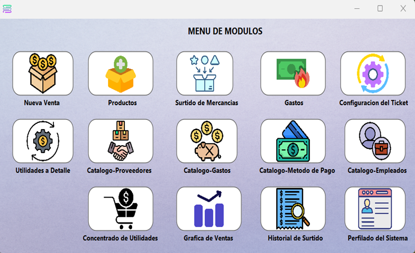

# 💻 Portafolio de Sistemas en Java y MySQL

Repositorio dedicado al almacenamiento y control de versiones de aplicaciones de escritorio desarrolladas en **Java (Swing)** con persistencia de datos en **MySQL**.

---

## 📂 Proyectos Incluidos

### 1. 🎫 TicketiX (Mesa de Ayuda)
Sistema integral de soporte técnico diseñado para optimizar la atención a usuarios y el control interno de TI[cite: 1, 11].
* **Gestión de Tickets:** Creación, asignación y seguimiento de incidencias[cite: 1, 11].
* **Control de Inventarios:** Administración de equipos y recursos[cite: 1, 11].
* **Reportes y Usuarios:** Generación de informes y administración de roles[cite: 1, 11].
* **Extras:** Integración de funciones con IA y respaldo de base de datos SQL[cite: 4, 5, 11].

### 2. 🛒 Vendette (Gestión Comercial y Gastos)
Sistema de administración operativa enfocado en el control financiero y cartera de clientes[cite: 10, 11].
* **Módulo de Clientes:** Registro y administración de información de clientes[cite: 10].
* **Catálogo de Gastos:** Control, clasificación y registro de egresos[cite: 10].
* **Concentrado:** Vista general y seguimiento de estatus operativos[cite: 10].
* **Base de Datos:** Incluye el script `Vendette.sql` listo para importar en MySQL[cite: 10].

---

## 🛠️ Tecnologías Utilizadas
* **Lenguaje:** Java (JDK)
* **Interfaz Gráfica:** Java Swing (NetBeans IDE)
* **Base de Datos:** MySQL (`JDBC`)
* **Gestión de Dependencias:** Maven (`pom.xml`)[cite: 10]

## 🚀 Instrucciones de Uso
1. Clona este repositorio o descarga el código fuente.
2. Importa los archivos `.sql` incluidos en la carpeta de cada proyecto dentro de tu gestor de **MySQL** (phpMyAdmin o MySQL Workbench)[cite: 10].
3. Abre el proyecto deseado en **NetBeans**[cite: 10].
4. Configura tus credenciales locales en la clase `conexion.java` (usuario, contraseña y puerto) y ejecuta el proyecto[cite: 10].

### 1. 🎫 Ticketix (Mesa de Ayuda)

### 2. 🎫 Vendette (Punto de Venta)

